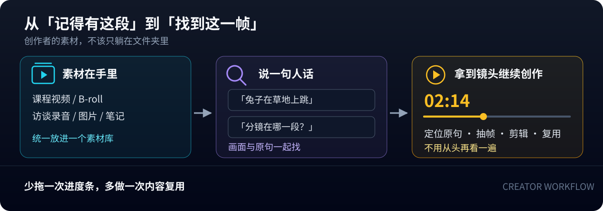
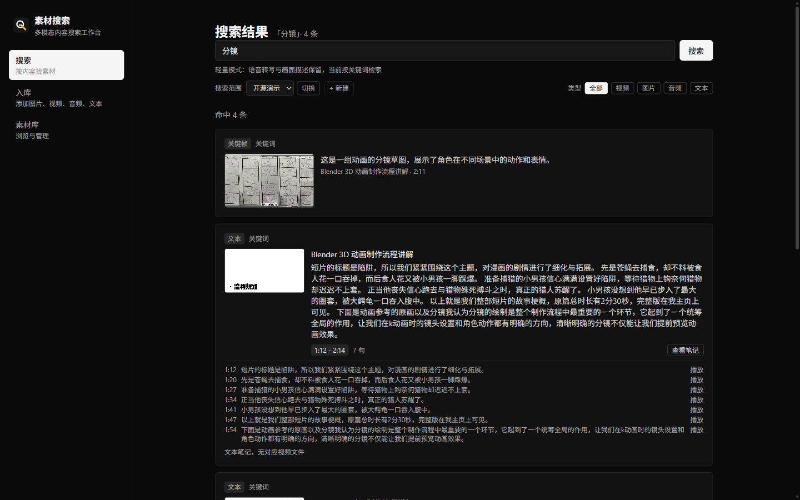
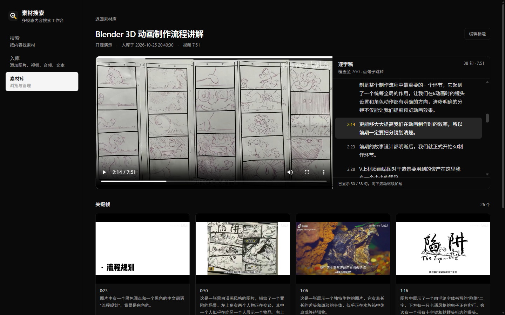
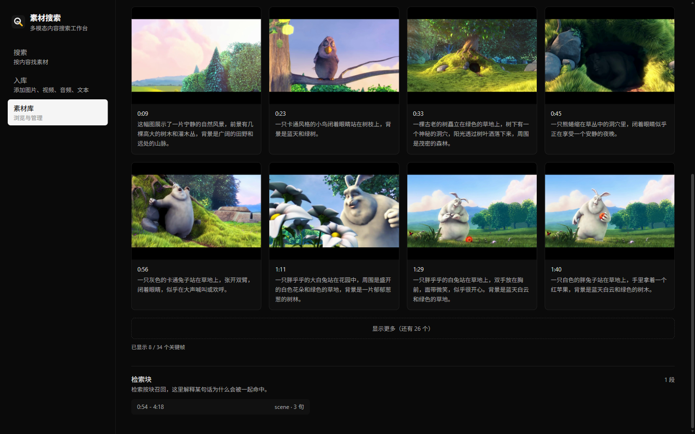

<div align="center">
  
  <h1>MaterialSeeker</h1>
  <p>为内容创作者打造的多模态素材检索工作台</p>
  <p><a href="README.md">中文</a> · <a href="README_EN.md">English</a></p>
  <p>
    <a href="LICENSE"></a>
    
    
    
    
    
    
    
  </p>
</div>

## 让旧素材随时能被重新使用

MaterialSeeker 面向视频创作者、课程作者、播客和知识型创作者。它把散落在硬盘里的课程、B-roll、访谈、截图和笔记，整理成一个可以按画面与语言检索的素材库。

你要找的不再只是一个文件名，而是能用于下一个视频的那一帧、那句话、那段操作示范。素材与索引保存在自己的机器上，模型和供应商可以按部署条件选择。

> [!TIP]
> **少拖一次进度条，多做一次内容复用。把找素材的时间还给创作本身。**

## 你能得到什么效果

| 创作现场 | 使用 MaterialSeeker 后 |
| --- | --- |
| 想找一段 B-roll | 直接描述「兔子在草地上跳」，命中对应关键帧和时间点，不必逐段拖视频 |
| 想复用课程或访谈内容 | 搜索一个概念或一句原话，跳到讲解的那一句，同时查看上下文和对应画面 |
| 想整理长期积累的素材 | 老视频、图片、音频和笔记进入同一个库，按素材库、标签、描述与关键词重新组织 |
| 想减少重复劳动 | 自动转写、场景检测、抽帧和画面描述，不再手工记时间码、逐张写备注 |

<picture>
  <source media="(max-width: 600px)" srcset="docs/assets/brand/creator-workflow.zh.compact.svg">
  
</picture>

一句话概括：**从「我记得有这段」到「找到这一帧，继续创作」。**

## 核心能力

| 能力 | 你能得到什么 |
| --- | --- |
| 多模态素材库 | 视频、图片、音频和文本放进同一个素材库，按主题或项目分类管理 |
| 转写与时间定位 | 中文语音转写、句级时间戳、点击句子跳转播放 |
| 场景与画面理解 | 自动检测场景、抽取关键帧，并为画面生成描述 |
| 关键词、语义与跨模态检索 | SQLite FTS5 关键词检索；标准版加入 EmbeddingGemma 2，支持文字直接检索图片、视频帧与音频内容 |
| 素材管理 | 标签与描述编辑、多选删除、复制或移动到其他素材库、导出 |
| 分步使用引导 | 从搜索、入库、素材库到详情编辑的四步指引，支持桌面与手机，可随时关闭并重新打开 |
| 灵活部署 | 无 GPU 的轻量档与启用本地向量的标准档，Web 与推理服务通过 HTTP 解耦 |

## 关键词、语义与跨模态检索分别做什么

MaterialSeeker 不只是把文件名和逐字稿放进一个搜索框。三种检索方式解决不同问题：

- **关键词检索**：用 SQLite FTS5 检索逐字稿和正文，并为视频与图片匹配标题、标签和画面描述；轻量版与标准版都可使用。
- **语义检索**：用向量找意思相近的内容，不要求查询与原文逐字相同，适合「按概念找课程」「按大意找访谈」。
- **跨模态检索**：把文字查询与图片、视频帧的视觉内容和音频内容放进同一个向量空间，直接找「画面里有什么」「声音里是什么」；音频同时保留语音转写，关键词与语义检索也能按语句命中并定位播放。

| 素材 | 实际被检索的内容 | 能解决什么问题 |
| --- | --- | --- |
| 视频 | 关键帧画面、帧描述、逐字稿与标题 | 既能找说过的话，也能直接找画面中的场景、人物、动作或物体，不要求逐字稿先提到它们 |
| 图片 | 图片本身的视觉向量，以及画面描述、标题和标签 | 没有说明文字的图片，也能在向量就绪后按视觉内容参与语义检索 |
| 音频 | 音频内容向量，以及语音转写、句级时间戳和转写块向量 | 可以用文字直接找声音内容，也可以按转写里的语句找并定位播放 |
| 文本笔记 | 正文及其语义向量 | 既能按关键词找原文，也能按相近意思找笔记 |

例如，查询「网球运动员滑步」既可能命中逐字稿里有相近讲解的课程，也可能命中呈现这个动作的视频关键帧；查询「球场上的环境声」则可以直接命中音频内容。文字、画面与声音在同一个检索入口里合并呈现。

## 文档导航

第一次使用时，按你的目标选择文档：

| 你想做什么 | 去哪里看 |
| --- | --- |
| 快速启动项目 | [快速开始](#快速开始) |
| 配置 API Key、选择模型、排查配置错误 | [API 密钥与运行配置](docs/configuration.md) |
| 查看推理服务接口、模型与部署细节 | [推理服务说明](services/inference/README.md) |
| 查看演示素材来源与许可 | [演示素材来源](docs/demo-media.md) |
| 参与开发、运行测试、了解同步约束 | [开发须知](AGENTS.md) |
| 查看许可证 | [Apache-2.0](LICENSE) |

## 界面预览

**统一搜索：课程画面与逐字稿一起命中**



**视频详情：播放、逐字稿与句级时间定位同屏**



**关键帧：场景画面与自动生成的描述**



演示素材来自 B 站公开视频，视频文件不纳入仓库。来源与许可说明见 [演示素材来源](docs/demo-media.md)。

## 两种部署档位

| 能力 | 轻量版 `light` | 标准版 `standard` |
| --- | --- | --- |
| 语音转写与句级时间戳 | 支持，云端 ASR | 支持，云端优先、本地 FunASR 兜底 |
| 场景检测、关键帧与画面描述 | 支持 | 支持 |
| 关键词检索 | 支持 | 支持 |
| 向量语义检索 | 不提供 | 提供 |
| 本地模型依赖 | 不安装 EmbeddingGemma 2，不启用 FunASR | EmbeddingGemma 2 必需，FunASR 可选 |
| 推理服务 | 只需 8281 | 8280 + 8281 |

未配置时默认使用 `standard`。轻量期间新增的素材不生成向量，切回标准档后可通过显式回填补齐，不会自动重算整个素材库。

## 快速开始

需要 Node.js、Python 和 FFmpeg。先克隆仓库：

```bash
git clone https://github.com/li-xiu-qi/MaterialSeeker.git
cd MaterialSeeker
```

### 启动 Web 应用

在仓库根目录进入 `apps/web`，安装依赖后选择一种方式启动：

```bash
cd apps/web
npm install

# Linux / macOS
MATERIALSEEKER_PROFILE=light npm run dev
```

Windows PowerShell：

```powershell
$env:MATERIALSEEKER_PROFILE = "light"
$env:MATERIALSEEKER_DATA_DIR = "C:/path/to/materialseeker-data"
npm run dev
```

打开 `http://localhost:9280`。只做文本、图片和页面验收时，可以不启动 Python 服务。

### 视频与音频处理

视频和音频入库还需要 8281 服务。以下命令以 Linux / macOS 为例，Windows 的等价启动方式见 [推理服务说明](services/inference/README.md)。

```bash
# 另开一个终端，在仓库根目录执行
cd services/inference
python3 -m venv .venv
source .venv/bin/activate
pip install -r requirements-light.txt
cp .env.example .env
# 编辑 .env：设置 light、FFMPEG_BIN、ASR_CLOUD_KEY 与 GLM_API_KEY
bash start.sh
```

需要向量语义检索时，改用 `standard`，并按同一文档配置模型与两个独立 Python 环境。

API Key 的获取方式、必填条件和常见报错见 [API 密钥与运行配置](docs/configuration.md)。

## 相关项目

- [HearSight](https://github.com/li-xiu-qi/HearSight)：视频音频处理、内容分析与分块索引链路的参考来源。
- [SmartImager](https://github.com/li-xiu-qi/Smartlmager)：图片检索与管理能力的参考来源。
- [推理服务说明](services/inference/README.md)：部署档位、接口、模型与启动配置。

MaterialSeeker 在这些实践基础上独立演进，与上述项目无隶属关系。

## 许可

Apache-2.0，见 [LICENSE](LICENSE)。
