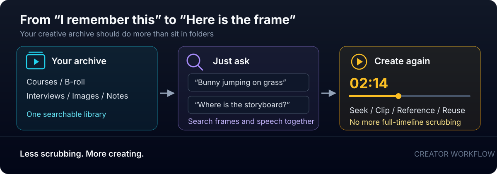

<div align="center">
  
  <h1>MaterialSeeker</h1>
  <p>A multimodal asset search workbench for content creators</p>
  <p><a href="README.md">中文</a> · <a href="README_EN.md">English</a></p>
  <p>
    <a href="LICENSE"></a>
    
    
    
    
    
    
    
  </p>
</div>

## Make your archive reusable

MaterialSeeker is built for video creators, course authors, podcasters, and knowledge creators. It turns scattered course recordings, B-roll, interviews, screenshots, and notes into one library you can search by visual content or natural language.

You are no longer limited to finding a filename. You can find the exact frame, quote, or software demonstration you need for your next video. Your media and indexes stay on your machine, while models and providers can be selected for your deployment.

> [!TIP]
> **Less scrubbing. More creating. Spend your time on the next video, not on finding the last one.**

## What you can achieve

| Creative task | What MaterialSeeker lets you do |
| --- | --- |
| Find a piece of B-roll | Describe a scene such as “bunny jumping on grass” and get the matching keyframe and timestamp instead of scrubbing the whole video |
| Reuse a course or interview | Search for a concept or an exact quote, jump to that sentence, and review the context and the matching visual |
| Build a long-term asset library | Bring old videos, images, audio, and notes into one place, organized by collection, tags, captions, and keywords |
| Reduce repetitive work | Automate transcription, scene detection, keyframe extraction, and frame captions instead of logging timecodes and writing notes manually |

<picture>
  <source media="(max-width: 600px)" srcset="docs/assets/brand/creator-workflow.en.compact.svg">
  
</picture>

In short: **go from “I remember this” to “here is the frame I can create with.”**

## Core capabilities

| Capability | What you get |
| --- | --- |
| Multimodal asset library | Videos, images, audio, and text in one library, organized by project or topic |
| Transcription and seeking | Chinese speech-to-text, sentence-level timestamps, and click-to-play navigation |
| Scene and visual understanding | Automatic scene detection, keyframe extraction, and AI-generated frame captions |
| Keyword, semantic, and cross-modal search | SQLite FTS5 keyword search, plus optional EmbeddingGemma 2 retrieval for text-to-image, text-to-video-frame, and text-to-audio search in the standard profile |
| Asset management | Edit titles, captions, and tags; bulk delete, copy, move, and export assets |
| Guided onboarding | A four-step tour through search, ingest, library browsing, and detail editing, with desktop/mobile layouts and an always-available entry point |
| Flexible deployment | A light profile without GPU requirements and a standard profile with local vectors, connected over HTTP |

## Keyword, semantic, and cross-modal search

MaterialSeeker does more than index filenames and transcripts. The three retrieval modes solve different problems:

- **Keyword search** uses SQLite FTS5 for transcript and note text, plus title, tag, and caption matching for video and image assets. It is available in both deployment profiles.
- **Semantic search** retrieves content with a similar meaning rather than requiring the exact wording, useful for finding a concept in a course or the gist of an interview.
- **Cross-modal search** places a text query, the visual content of images and video frames, and the content of audio in the same vector space, so you can search for what is visible or audible; audio also keeps speech transcripts, so keyword and semantic search can still match spoken sentences and seek to them.

| Asset | What is actually indexed and searched | What this enables |
| --- | --- | --- |
| Video | Keyframe visuals, frame captions, transcripts, and titles | Find spoken ideas or search directly for scenes, people, actions, and objects that may never be mentioned in the transcript |
| Image | Visual embeddings of the image itself, plus captions, titles, and tags | Images without written descriptions can still participate in visual semantic search once their vectors are ready |
| Audio | Audio content embeddings, plus speech transcripts, sentence timestamps, and transcript-chunk vectors | Search audible content directly with text, or find and seek to spoken sentences through the transcript |
| Text notes | Body text and its semantic vector | Use both exact keywords and related concepts to find notes |

For example, “a tennis player sliding” may match a course transcript containing a related explanation or a video keyframe showing the action; “stadium crowd noise” can match audio content directly. Text, visuals, and sound appear together in one search entry point.

## Documentation

Start with the document that matches your goal:

| What you need | Where to go |
| --- | --- |
| Get the project running | [Quick start](#quick-start) |
| Configure API keys, choose models, or troubleshoot configuration | [API keys and runtime configuration](docs/configuration.en.md) |
| Inspect inference endpoints, models, and deployment details | [Inference service guide](services/inference/README.md) |
| Review demo media sources and licenses | [Demo media sources](docs/demo-media.md) |
| Contribute, run tests, or review synchronization rules | [Development guide](AGENTS.md) |
| Read the license | [Apache-2.0](LICENSE) |

## UI preview

**Unified search: course frames and transcript hits in one result set**


**Video details: playback, transcript, and sentence-level seeking together**


**Keyframes: scene images with generated descriptions**


The demo videos come from public Bilibili pages and are not included in the repository. See [demo media sources and licenses](docs/demo-media.md).

## Deployment profiles

| Capability | Light `light` | Standard `standard` |
| --- | --- | --- |
| Speech-to-text and sentence timestamps | Supported through cloud ASR | Cloud-first, with local FunASR fallback |
| Scene detection, keyframes, and frame captions | Supported | Supported |
| Keyword search | Supported | Supported |
| Vector semantic search | Not included | Included |
| Local model dependencies | No EmbeddingGemma 2 or FunASR | EmbeddingGemma 2 required; FunASR optional |
| Inference services | 8281 only | 8280 and 8281 |

The default is `standard` when no profile is configured. Assets added in light mode do not receive vectors. After switching to standard, you can backfill them explicitly instead of rebuilding the entire library automatically.

## Quick start

You need Node.js, Python, and FFmpeg. Clone the repository first:

```bash
git clone https://github.com/li-xiu-qi/MaterialSeeker.git
cd MaterialSeeker
```

### Start the web app

From the repository root, enter `apps/web`, install dependencies, and start the app:

```bash
cd apps/web
npm install

# Linux / macOS
MATERIALSEEKER_PROFILE=light npm run dev
```

Windows PowerShell:

```powershell
$env:MATERIALSEEKER_PROFILE = "light"
$env:MATERIALSEEKER_DATA_DIR = "C:/path/to/materialseeker-data"
npm run dev
```

Open `http://localhost:9280`. You do not need a Python service for text, images, or UI checks.

### Video and audio processing

Video and audio ingestion also requires the 8281 service. These commands use Linux / macOS. See the [inference service guide](services/inference/README.md) for the equivalent Windows setup.

```bash
# In a separate terminal, from the repository root
cd services/inference
python3 -m venv .venv
source .venv/bin/activate
pip install -r requirements-light.txt
cp .env.example .env
# Edit .env: light profile, FFMPEG_BIN, ASR_CLOUD_KEY, and GLM_API_KEY
bash start.sh
```

For vector-based semantic retrieval, use `standard` and configure the model and the two separate Python environments described in the same guide. On edge devices such as Intel NPU, the 8280 encoder can switch to LiteRT-LM; see the “Edge / Intel NPU backend” section of the [inference service guide](services/inference/README.md).

For API key setup, required credentials, and troubleshooting, see [API keys and runtime configuration](docs/configuration.en.md).

## Related projects

- [HearSight](https://github.com/li-xiu-qi/HearSight): the reference for audio and video processing, content analysis, and chunk-based indexing.
- [SmartImager](https://github.com/li-xiu-qi/Smartlmager): the reference for image search and asset management.
- [Inference service guide](services/inference/README.md): deployment profiles, HTTP endpoints, models, and service configuration.

MaterialSeeker evolves independently from these projects and is not affiliated with them.

## License

Apache-2.0. See [LICENSE](LICENSE).
